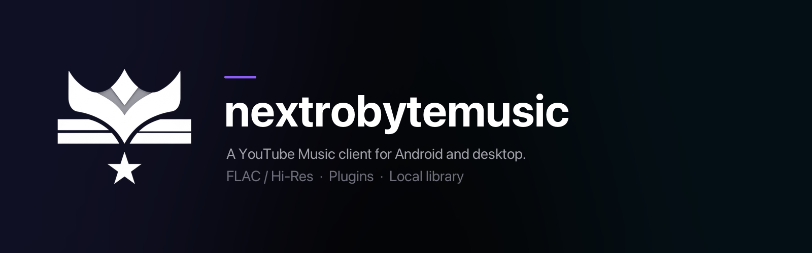

<div align="center">

<br/>


# nextrobytemusic

### A YouTube Music client for Android and desktop

<br/>

[](https://github.com/barankrky/nextrobytemusic/releases)
[](https://github.com/barankrky/nextrobytemusic/blob/main/LICENSE)
[](https://github.com/barankrky/nextrobytemusic/commits/main)

<br/>

[**Build & Run**](#build) · [**Features**](#features) · [**Contributing**](#contributing) · [**Credits**](#credits) · [**Disclaimer**](#disclaimer)

</div>

> [!IMPORTANT]
> nextrobytemusic is not affiliated with, endorsed by, or connected to YouTube or Google in any way. Use it at your own discretion.

---

<div align="center">



<h1><a id="features"></a>Features</h1>

<table>
  <tr>
    <td width="50%" valign="top">

#### Playback
- **Search, browse and play** anything available on YouTube Music.
- **Hi-Res lossless audio** — FLAC/ALAC from a configured module or addon source, with YouTube Music as fallback.
- **Gapless playback with true crossfade**, adjustable 0–12s.
- **Automix [Beta]** — DJ-style transitions with beat-matching and tempo-stretching.
- **Offline downloads** — save tracks for local playback, including FLAC/hi-res streams from configured modules and addons.
- **Local music library** integration.
- **Background playback** on Android; tray playback on desktop.
- **Apple-like lyrics animation** — credit to [binimum](https://github.com/binimum/am-lyrics).

#### Connectivity & Accounts
- **Sign in with your Google account** for personalized content.
- **Spotify integration** — connect your account to play your playlists and Liked Songs.
- **Discord Rich Presence** — in-app login, live track/artist/album and progress.
- **Scrobbling** to Last.fm and ListenBrainz.
- **Pluggable sources** — add, edit, test and health-check modules and addons.

    </td>
    <td width="50%" valign="top">

#### Experience
- **Animated album canvas** — motion artwork on the now-playing screen.
- **Word-synced lyrics** — word/syllable-level highlighting from multiple sources.
- **Lyrics providers** — credit to [lrc.red](https://lrc.red), [BiniLyrics](https://github.com/binimum), [BetterLyrics](https://github.com/better-lyrics/better-lyrics), [PaxSenix](https://lyrics.paxsenix.org), [LyricsPlus](https://github.com/ibratabian17/YouLyPlus), [SimpMusic](https://github.com/maxrave-dev/SimpMusic), [Unison](https://unison.boidu.dev), [Megalobiz](https://www.megalobiz.com), [KuGou](https://www.kugou.com), [LRCLIB](https://lrclib.net), [Musixmatch](https://www.musixmatch.com) and [Genius](https://genius.com).
- **Dynamic, artwork-driven theming** — Material palette extracted from album art.
- **Frosted-glass UI** — Telegram-style translucent bars via Haze, Material 3 theming.

#### Controls & Tweaks
- **Per-network audio quality** on Android — separate quality ceilings for Wi-Fi and mobile data.
- **Playback speed control** (0.5×–2.0×) and **skip silence**.
- **Sleep timer** — fixed presets or "stop after this track".
- **Equalizer** — Android's system equalizer, plus a built-in one on desktop.
- **Stats for nerds** — codec, bit depth, sample rate, and more on the now-playing screen.

    </td>
  </tr>
</table>

</div>

---

<div align="center">

<h1><a id="build"></a>Build & Run</h1>

Release builds are published on the [Releases](https://github.com/barankrky/nextrobytemusic/releases) page.

</div>

### Android

Requirements: JDK 17 or newer, Android SDK with `compileSdk 37`, and NDK `27.0.12077973`. Minimum supported Android version is 8.0 (API 26).

```bash
./gradlew :app:assembleProdRelease
```

APKs are written to `app/build/outputs/apk/prod/release/`. Signed release builds read `keystore.properties`; copy [`keystore.properties.example`](keystore.properties.example) and fill it in. Without it, the release build is unsigned.

`local.properties` is not committed. Point `sdk.dir` at your Android SDK, or set `ANDROID_HOME`.

### Desktop

Requirements: JDK 21. The desktop target runs on Windows, Linux and macOS.

```bash
./gradlew :desktopApp:run
```

For packaging, release assets and the optional native components, see [DESKTOP.md](DESKTOP.md).

### Tests

```bash
./gradlew :shared:jvmTest :desktopApp:test
```

---

<div align="center">

<h1><a id="contributing"></a>Contributing</h1>

Contributions to nextrobytemusic are welcome. Please read the [Contributing Guide](CONTRIBUTING.md) and [Code of Conduct](CODE_OF_CONDUCT.md) before opening a pull request.

[**Issues**](https://github.com/barankrky/nextrobytemusic/issues) · [**Contributing Guide**](CONTRIBUTING.md) · [**Code of Conduct**](CODE_OF_CONDUCT.md)

</div>

---

<div align="center">

<h1><a id="credits"></a>Credits</h1>

nextrobytemusic is a rebranded fork of [BitChord](https://github.com/kushagrasinghx/BitChord). The upstream project and the open-source libraries this app is built on — Kotlin, Compose Multiplatform, AndroidX/Media3, FFmpeg, NewPipeExtractor, Coil, Haze, and the lyrics providers listed above — remain under their original licenses.

</div>

---

<div align="center">

<h1><a id="disclaimer"></a>Disclaimer & Legal Notice</h1>

nextrobytemusic is an independent, community-driven third-party audio player and client. It is **not** associated with Google LLC, YouTube Music, or any of their parent companies.

* **No Media Hosting:** nextrobytemusic does not host, upload, or store copyrighted music files. It operates strictly as an interface to scan local device storage or stream media directly from public, public-facing, or user-authenticated APIs.
* **Third-Party Sources:** Modules, addons and other configured sources are third-party software and services. Their use, availability and legality are the user's responsibility.
* **Fair Use & API Usage:** This software is created solely for personal research, educational, and fair-use purposes. The user is entirely responsible for ensuring their usage aligns with their local copyright laws and YouTube Terms of Service.
* **No Ad-Blocking Guarantee:** nextrobytemusic focuses on providing a clean listening environment; it does not guarantee permanent bypasses or modifications to commercial third-party platform conditions.
* **Copyleft:** nextrobytemusic is free software under the GPLv3. The license does not let anyone forbid others from selling or redistributing copies, but any distribution must come with the Corresponding Source under the same license.

</div>

---

<div align="center">

<h1><a id="license"></a>License</h1>

This project is licensed under the **GNU General Public License v3.0 (GPLv3)**. See the [LICENSE](LICENSE) file for details.

</div>
